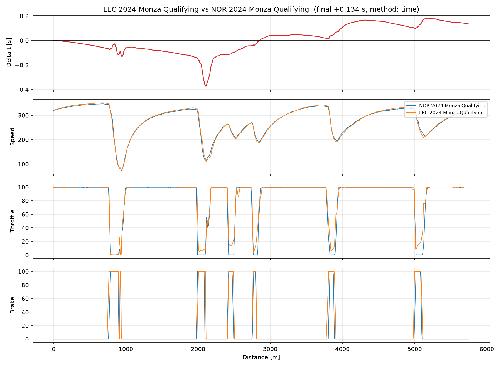
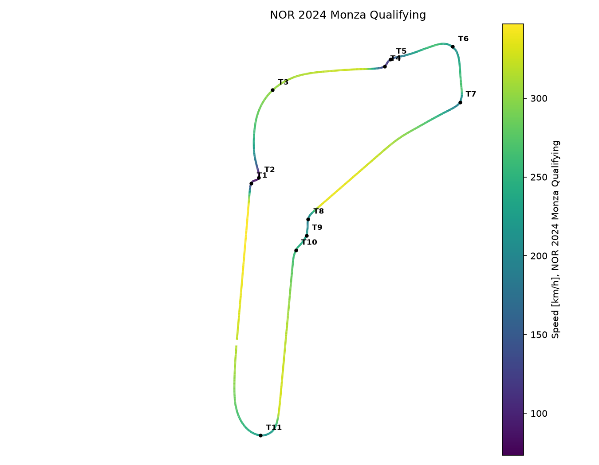
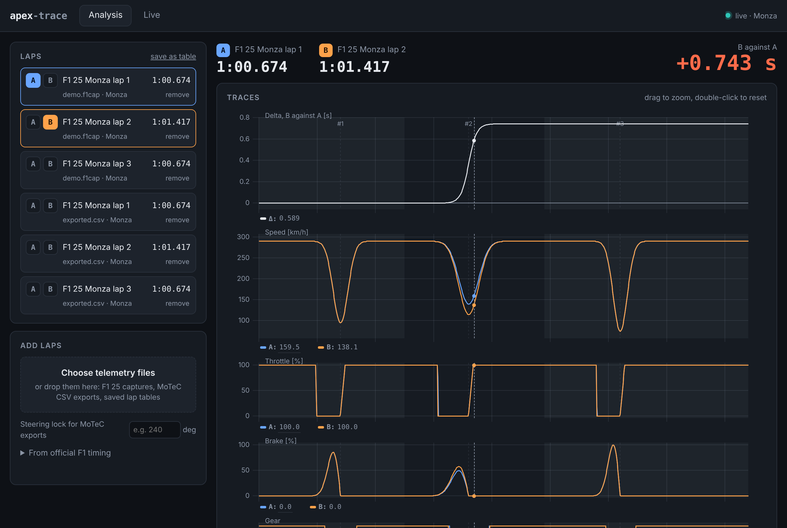
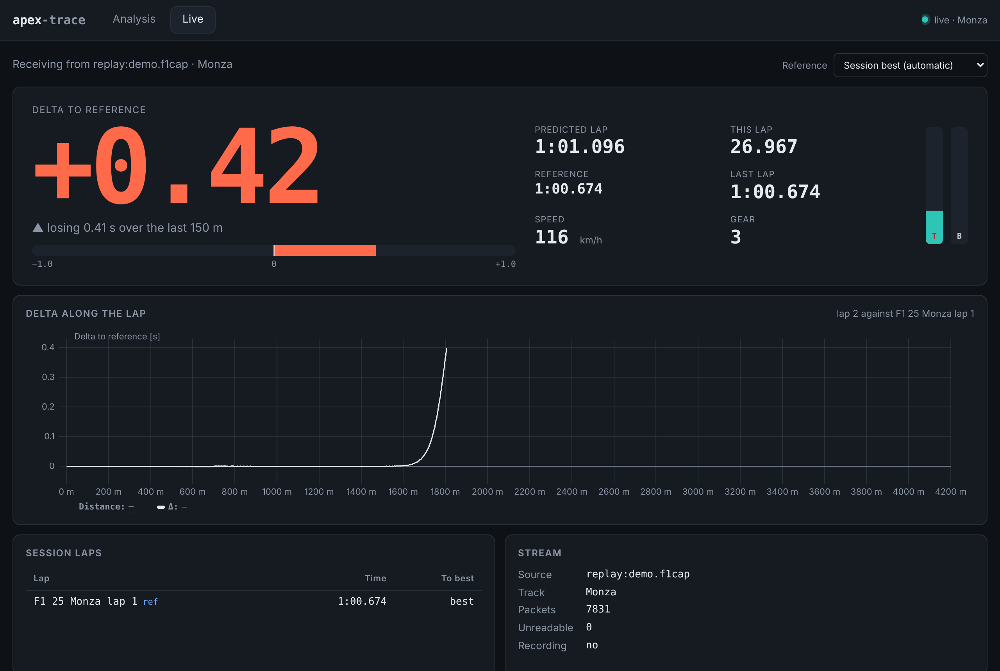

# apex-trace


Source-agnostic race telemetry analysis.

The goal: ingest lap telemetry from any source (real F1 timing data via
[FastF1](https://github.com/theOehrly/Fast-F1), or racing sims like Assetto
Corsa and F1 25), normalise it onto a canonical distance-based representation,
and run the same comparison engine on top: cumulative time delta, channel
overlays, corner-by-corner segmentation and driving metrics.

**Status: 0.7, roadmap complete (M0 to M7): three sources, one engine,
a web app with live delta. See [What is left before 1.0](#what-is-left-before-10).**

## Headline result



Leclerc vs Norris, Monza 2024 qualifying. The top panel is the cumulative
time delta (positive means Leclerc behind); the channels below explain it.
Leclerc gains steadily on the straights with a lower-drag Ferrari and brakes
visibly later into the Roggia chicane (the sharp spike at 2100 m), but pays
on every corner exit; the Lesmos and Ascari account for the 0.134 s he
concedes over the lap.

The engine is validated against official timing gaps in five scenarios
(fast, slow and street tracks; qualifying and race laps): zero measured
error for the default method. Reproduce with `examples/validate_delta.py`.

## Corner by corner

The same lap pair, segmented and read the way a race engineer would say it:

```
corner apex_a_kmh apex_b_kmh brake_m  apex_m power_m coast_a_m coast_b_m entry_s  exit_s total_s
 T1-T2       73.1       75.0   -24.2     0.1     6.3      10.0       5.0  +0.062  -0.215  -0.154
 T4-T5      113.7      111.4     6.7     5.0    -0.3       5.0       0.0  -0.134  +0.243  +0.110
    T6      207.2      204.1     1.4     0.0     0.0       5.0       0.0  +0.082  +0.015  +0.097
    T7      190.4      187.3   -10.0    -4.9    15.5      10.0       0.0  +0.072  -0.065  +0.007
 T8-T9      194.1      191.0   -26.1    -5.8    11.8      15.0       0.0  -0.047  +0.123  +0.076
   T11      215.1      209.3    -5.9   -20.2    -0.0      20.0       0.0  -0.048  +0.047  -0.001
```

Corners are speed minima found by peak detection with thresholds in
physical units; segments tile the lap at the midpoints between apexes, so
the per-corner deltas sum to the full-lap delta exactly (here +0.134 s,
matching official timing). Positive position deltas mean lap B does it
later along the track: Leclerc brakes 6.7 m deeper into Roggia but gets
back to full throttle 15.5 m later out of Lesmo 2 and 11.8 m later out of
Ascari, which is where the lap is lost. Labels come from the official
corner marks, projected onto the driven line via the position channels.



The same marks anchor the distance-axis alignment between the two laps
(each lap measures the track with its own integrated odometer, so the axes
disagree by metres). Validated against official sector times: interior
delta error drops from 0.069 s to 0.043 s RMS across the five scenarios.
Reproduce with `examples/validate_alignment.py`.

## Why source-agnostic

Comparing two laps rigorously means resampling every channel onto a common
distance axis. Once that normalisation exists, the analysis engine stops
caring where the data came from: adding a new telemetry source is just
writing one more loader that produces the same canonical `Lap`. That
source-independence is the point of the project.

## Three sources, one engine

The claim was tested twice, with sources chosen to be as unlike the
first as possible.

| Source | Kind of source | Loader | Engine lines changed |
| --- | --- | ---: | ---: |
| F1 timing data (FastF1) | archive behind an API | 132 lines | (written alongside) |
| F1 25 | live binary UDP stream | 965 lines | 0 |
| MoTeC i2 CSV (Assetto Corsa, real loggers) | text file exported by hand | 424 lines | 0 |

The loaders did not get cheaper in a straight line, and the table is
not meant to suggest they did: the F1 25 one is the largest because a
live binary broadcast is the hardest thing to turn into a lap. What the
table shows is where the cost went. Every line of it is in the loader;
`delta.py`, `corners.py`, `report.py` and `plots.py` have not changed by
a character since they were written for F1 timing data.

**F1 25** broadcasts binary UDP packets at up to 60 Hz with no lap
boundaries, no lap times and no distance axis attached. The loader
reassembles frames from separate datagrams, cuts laps on the lap
counter, and closes the distance axis at both ends. Recording writes
raw datagrams straight to disk without parsing them: the stream is live
and unrepeatable, so a decoding bug should cost a re-run of the loader,
not a re-run of the session.

**MoTeC i2 CSV** is where Assetto Corsa telemetry ends up (the ACTI and
Telemetrick apps log in MoTeC's format), and equally where a real car's
MoTeC logger ends up. Channel names are whatever the logging setup
called them, units are stated per channel and converted rather than
assumed, and laps are cut at the beacon markers with both ends
interpolated onto the beacon instant.

`examples/f1_25_demo.py` runs the F1 25 path end to end with no game
and no network, on synthetic packets built at the wire level from laps
whose kinematics are known in closed form. Two laps identical but for
one slower corner:

```
F1 25 Monza lap 1: 841 grid points, 60.674 s (exact 60.674 s)
F1 25 Monza lap 2: 841 grid points, 61.417 s (exact 61.417 s)

full-lap delta +0.743 s, exact difference +0.743 s

corner apex_a_kmh apex_b_kmh brake_m  apex_m power_m coast_a_m coast_b_m entry_s  exit_s total_s
    #1       95.0       95.0     0.0     0.0     0.0      40.0      40.0  +0.000  +0.000  +0.000
    #2      140.0      115.0    -5.0     0.0     0.0      65.0      60.0  +0.372  +0.371  +0.743
    #3       75.0       75.0     0.0     0.0     0.0      35.0      40.0  -0.000  +0.000  -0.000
```

The delta engine recovers the lap time difference exactly and puts all
of it in corner #2, the only place the two laps differ.

Laps can be kept two ways. The raw recording is the record of a session:
it replays as if live and can always be decoded again. Once decoded,
laps from any source save to one plain table (CSV, the same file
whichever loader made them) that reloads without decoding and opens in
a spreadsheet:

```bash
uv run apextrace record monza.f1cap                  # raw UDP, while driving
uv run apextrace extract monza.f1cap -o monza.csv    # canonical laps, as a table
```

`examples/cross_source.py` puts a sim lap against the real pole lap of
the same circuit, the comparison the whole design exists to allow.

What the sims add that F1 timing data does not have: an analogue brake
trace instead of a near on/off signal, and a steering channel. What
they lack: official corner marks, which are reference data about a real
circuit. Corners are still detected and numbered, they just lose their
names, which is what "cosmetic by design" meant in M3.

## The app

One place for both jobs: comparing laps after a session, and reading a
delta against a reference lap while driving.

```bash
uv sync --extra app
uv run apextrace serve                        # analysis + live F1 25 on UDP 20777
uv run apextrace serve --record monza.f1cap   # same, keeping the raw stream
uv run apextrace serve --replay monza.f1cap   # relive a recorded session
uv run apextrace serve --no-live a.f1cap b.csv --steering-lock 240
```

`serve` is the only command that needs the app extra; `record` and
`extract` run on the engine alone.



**Analysis.** Laps from any source sit in one list: drop in F1 25
captures, MoTeC exports or saved lap tables, or download a lap from F1
timing. Pick a
reference lap A and a lap B and the engine's results are laid out on a
shared distance axis: delta, channel overlays with a synced cursor and
zoom, a track map coloured by where the time goes, the corner table,
and the behaviour table. The session's laps save as one table from the
lap list. Laps of different circuits are refused, and laps from
different sources are compared with a note that the result is
qualitative.



**Live.** The lap in progress against a reference lap, pushed over a
WebSocket at the stream's own rate: the delta, whether it is being won
or lost over the last 150 m, the predicted lap time, and the delta
along the lap so far. The reference follows the session best unless a
lap is pinned, and any lap the app holds can be pinned, including one
from another session's capture. Start the app with `--host 0.0.0.0` to
put this view on a tablet or phone next to the wheel.

The live delta is one interpolation of the reference lap's time channel
(`apextrace/live.py`), and it is source-agnostic for the same reason as
everything else. A replayed capture goes through exactly the same code
as a live socket, paced by the arrival times stored in the file, which
is what makes the live path testable without sitting in the car. The
screenshots above are that: a synthetic session being replayed.

The app is FastAPI and a WebSocket on the server and plain JavaScript
modules in the browser, with no build step; the charting library
([uPlot](https://github.com/leeoniya/uPlot), MIT) is vendored so the
app works with no network. It has no accounts and is meant for the
machine it runs on or a home network. It does refuse requests that do
not name this machine as their host or that come from another site's
pages, which closes the one way into a local app from outside: the
user's own browser.

## Driving behaviour

The corner report says where time is gained or lost. `behaviour.py`
reads the inputs behind it, per corner: brake peak, metres from brake
point to peak and from peak to release, metres of braking while already
turning (trail braking), metres from throttle pickup to full throttle,
lifts on the way there, steering reversals, and metres of brake and
throttle together.

```
corner  brake_peak  brake_build_m  brake_release_m  trail_brake_m  throttle_ramp_m  throttle_hesitations  steering_reversals  pedal_overlap_m
    #1          86             92               46             90               38                     0                   1                0
    #2          49            102               58            138               38                     0                   1                0
    #3         100             92               46             90               38                     0                   1                0
```

Exploratory, and the word heuristic is meant literally. Each number is
a simple, stated reading of a trace in physical units, with every
threshold exposed as a parameter. None is a score: a long brake release
is technique in one corner and hesitation in another. The use is
comparative, the same corner on two laps. Steering thresholds are
relative to each corner's own peak steering, so the metrics do not
depend on how a source normalises its steering channel. The table above
is from the synthetic session, whose pedal traces are fillers; it shows
the output, not driving.

### Accelerations without an accelerometer

A car's planar motion is described by how fast it goes and where, so
the accelerations are derived from channels every lap already has:
longitudinal as the rate of change of speed, lateral as speed squared
times the curvature of the driven line (`gforce.py`). That makes them
available for any source with a position channel, F1 timing data
included, on a single definition, and leaves the canonical schema
alone.

```
corner  brake_g  accel_g  lat_g  combined_g  trail_g_m  power_g_m
    #1     2.78     2.80   0.99        2.85     100.00      95.00
    #2     1.81     1.72   0.99        1.90     140.00     140.00
    #3     3.11     3.15   0.99        3.18      95.00      95.00
```

`trail_g_m` and `power_g_m` are the vehicle-dynamics reading of a
corner's phases: metres spent slowing and turning at once, and metres
spent turning and accelerating at once. The first is trail braking seen
from the car rather than from the pedal, which is the only way to see
it on F1 timing data, where the brake channel is on/off and there is no
steering. `examples/gg_diagram.py` plots the two accelerations against
each other.

These are estimates, and the cost is differentiation: speed arrives in
whole km/h and position is noisy, and a derivative amplifies both. The
derivatives are taken with a Savitzky-Golay filter whose two windows
(50 m for speed, 100 m for position) are parameters in metres. A window
wider than a corner flattens its peak, so a figure quoted from here
should say which windows it was computed with. The table is again from
the synthetic session, which is driven round a circle.

## Stack

Python 3.12+ · pandas · NumPy · SciPy · matplotlib · FastF1 · managed with
[uv](https://github.com/astral-sh/uv). The app adds FastAPI, uvicorn and
uPlot as an optional extra; the engine and the loaders do not depend on
them.

## Quick start

```bash
uv sync --extra app
uv run python examples/hello_fastf1.py       # smoke test: lap times
uv run python examples/plot_speed_trace.py   # one lap through the pipeline
uv run python examples/compare_laps.py       # delta + overlays, two laps
uv run python examples/validate_delta.py     # engine vs official timing
uv run python examples/check_corners.py      # corner detection + events
uv run python examples/corner_report.py      # per-corner comparison table
uv run python examples/track_map.py          # map coloured by speed
uv run python examples/validate_alignment.py # alignment vs sector times
uv run python examples/f1_25_demo.py         # F1 25 path, no game needed
uv run python examples/behaviour_report.py   # input heuristics, same session
uv run python examples/gg_diagram.py         # derived accelerations, g-g plot
uv run pytest                                # synthetic test suite, no network
```

The first run of a FastF1 example downloads one F1 session into a local
cache (`.fastf1_cache/`, takes a minute or two); subsequent runs are
near-instant. With the game or an export to hand:

```bash
uv run python examples/f1_25_record.py monza.f1cap     # while driving F1 25
uv run python examples/f1_25_analyse.py monza.f1cap    # afterwards
uv run python examples/motec_compare.py outing.csv --steering-lock 240
uv run python examples/cross_source.py monza.f1cap     # sim lap vs real pole
```

To see the app with no game: `uv run python examples/f1_25_demo.py
--capture demo.f1cap`, then `uv run apextrace serve --replay demo.f1cap
--loop`.

Loading laps in your own code, one line per source, same `Lap` out:

```python
from apextrace.loaders.fastf1_loader import load_fastf1_lap
from apextrace.loaders.f1_25 import load_f1_25_capture, load_f1_25_lap
from apextrace.loaders.motec_csv import load_motec_csv
from apextrace.storage import load_laps, save_laps

lap = load_fastf1_lap(2024, "Italian Grand Prix", "Q", "NOR")
lap = load_f1_25_lap("monza.f1cap")                      # fastest valid lap
laps, skipped = load_f1_25_capture("monza.f1cap")        # all, skipped says why
laps, notes = load_motec_csv("outing.csv", steering_lock=240)

lap.data.head()   # canonical channels on a uniform 5 m distance grid
lap.lap_time      # seconds

save_laps(laps, "session.csv")    # canonical laps as a table
laps = load_laps("session.csv")   # and back, bit for bit
```

## Roadmap

- [x] **M0**: skeleton, environment, FastF1 data chain
- [x] **M1**: canonical `Lap` (uniform distance grid) + FastF1 loader
- [x] **M2**: cumulative time-delta engine + channel overlays
- [x] **M3**: corner segmentation, per-corner report, landmark alignment
- [x] **M3.5**: automated tests (pytest) + CI
- [x] **M4**: second loader (F1 25 via UDP) through the same, untouched engine
- [x] **M5**: unified app: post-session analysis + live delta while driving
- [x] **M6**: driving-behaviour heuristics from sim channels and derived accelerations (exploratory)
- [x] **M7**: third loader (MoTeC CSV: Assetto Corsa and real loggers), marginal cost measured

## Honest limits

Cross-source comparisons (real F1 vs sim) are qualitative: car, tyres,
downforce and track geometry all differ, so a numeric delta between sources
does not mean "you are X seconds slower". Within one source the comparison
is quantitative. FastF1 telemetry has no steering channel and a near on/off
brake signal; the richer channels live in sim data.

The live delta is for the driver, the post-session delta is the one to
quote. A lap in progress has not reached the far line, so its distance
axis cannot be reconciled with the reference's the way two finished
laps are; the live number carries whatever the two odometers disagree
by, which is metres, so hundredths of a second.

The behaviour metrics are measured on the distance grid, so no length
is finer than one grid step (5 m by default). Load laps with a finer
`step` for input analysis.

The derived accelerations assume planar motion, so elevation and
banking are ignored, and the sign of the lateral one follows the
handedness of each source's map: compare magnitudes across sources,
signs only within one. Their smoothing windows were chosen from the
noise the sources have, not tuned on real laps.

## What is left before 1.0

The two sim loaders are verified, not yet validated, in the same sense
the delta engine was before `examples/validate_delta.py` was pointed at
official timing.

The F1 25 loader is written against the published UDP specification and
tested against packets built to that specification byte for byte. The
MoTeC loader is written against the format's structure as other tools
write it (MoTeC publish no specification) and tested on files written
to that structure. Both cover the layouts, the lap cutting and the
anchoring of the distance axis; neither can catch a place where the
real thing differs from its description, and neither has yet been run
on real data. The first real capture and the first real export are the
tests that matter, and 1.0 is the version after they pass:

- an F1 25 session recorded with `examples/f1_25_record.py` decodes to
  laps whose times match the game's own;
- a MoTeC i2 export of an Assetto Corsa outing loads with the channel
  names it actually uses (the alias table is the likeliest thing to
  need a line added) and its lap times match i2's;
- the derived accelerations of a real F1 lap land where an F1 car is
  known to be (around 5 g under braking, 4 to 6 g in fast corners) with
  the default windows, or the defaults move.
